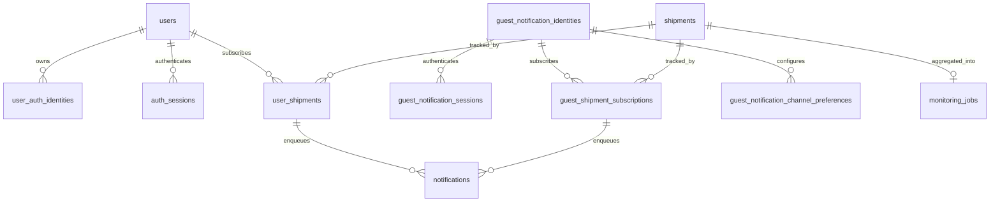

# Milestone 3 - Stage 13 Technical Architecture & Completion Report
**India Post AI Shipment Assistant**
**Date**: November 2026 | **Schema Version**: 11 | **Status**: Verified & Concluded (937/937 Tests Passing)

---

## 1. Executive Summary

Milestone 3 - Stage 13 establishes the enterprise-grade identity, dual-ownership notification architecture, and secure inbound webhook linking for the India Post AI Shipment Assistant.

Prior to Stage 13, shipment tracking was limited to registered users or ephemeral browser chats. Stage 13 introduces:
1. **Registered Passwordless Authentication**: Single-use cryptographic OTP challenges via email, bounded attempt lockouts, rate limiting, and secure opaque session tokens.
2. **Durable Guest Notification Identities**: Persistent, server-side guest entities held in SQLite, authenticated via opaque HttpOnly cookie sessions, enabling unauthenticated web visitors to subscribe to shipment tracking across restarts.
3. **Audit-Ready Explicit Consent**: Enforced capture of consent timestamps and channel verification before any notification can be scheduled or dispatched.
4. **Inbound Telegram Webhook Linking**: Secure, single-use linking challenges where Telegram `chat_id` values are resolved exclusively from verified inbound Telegram webhook updates—never trusted from user or browser input.
5. **Multi-Owner Monitoring Aggregation**: Intelligent deduplication and interval arbitration across overlapping registered and guest subscriptions for the same shipment.
6. **Unified Outbox & Fail-Closed Authorization**: Mutual exclusivity in notification outbox records (`user_shipment_id` vs `guest_subscription_id`) with real-time fail-closed delivery authorization checks immediately prior to channel dispatch.

---

## 2. Architecture & Data Model (Migration 11)

### 2.1 Database Schema Evolution

Migration 11 was applied transactionally to `shipments.db`, elevating the schema from Version 10 to Version 11. It introduced 8 new/updated tables:



### 2.2 Table Specifications

1. `user_auth_identities`: Binds canonical `user_id` to verified email identities (`user_id`, `identity_type`, `identifier`, `verified_at`, `created_at`).
2. `auth_challenges`: Manages short-lived single-use OTP challenges (`challenge_id`, `identity_type`, `identifier`, `challenge_hash`, `attempt_count`, `max_attempts`, `expires_at`, `consumed_at`, `created_at`).
3. `auth_sessions`: Manages opaque 32-byte bearer/cookie sessions for registered users (`token_hash`, `user_id`, `created_at`, `last_active_at`, `expires_at`, `revoked_at`).
4. `guest_notification_identities`: Durable anchor for unauthenticated subscribers (`guest_identity_id`, `created_at`, `revoked_at`, `notes`).
5. `guest_notification_sessions`: Independent opaque session tokens for guest notification management (`token_hash`, `guest_identity_id`, `created_at`, `last_active_at`, `expires_at`, `revoked_at`).
6. `guest_shipment_subscriptions`: Maps guest identities to shipment records with independent intervals (`guest_subscription_id`, `guest_identity_id`, `shipment_id`, `monitoring_enabled`, `monitoring_interval_hours`, `next_check_at`, `monitoring_completed_at`, `created_at`, `updated_at`).
7. `guest_notification_channel_preferences`: Tracks channel opt-in, verification, and explicit consent (`preference_id`, `guest_identity_id`, `channel`, `recipient`, `enabled`, `verified_at`, `consent_at`, `created_at`, `updated_at`).
8. `telegram_link_challenges`: Single-use deep linking tokens (`challenge_id`, `owner_type`, `user_id`, `guest_identity_id`, `challenge_code_hash`, `expires_at`, `consumed_at`, `telegram_chat_id`, `created_at`).

### 2.3 `notifications` Rebuild & Mutual Exclusivity

The `notifications` table was rebuilt transactionally in SQLite with foreign keys disabled during replacement to ensure integrity:
```sql
CHECK (
    (user_shipment_id IS NOT NULL AND guest_subscription_id IS NULL) OR
    (user_shipment_id IS NULL AND guest_subscription_id IS NOT NULL)
)
```
Historical attempts, delivery receipts, and idempotent dispatch keys were 100% preserved.

---

## 3. Workstream Implementations

### Workstream 1-3: Registered Passwordless Authentication
- Module: `auth/passwordless_service.py` & `database/auth_repository.py`
- Generates 6-digit cryptographic numeric OTPs.
- Hashes challenge codes using SHA-256 (`challenge_hash`) so plain text secrets are never stored.
- Enforces max attempts (default 3) before invalidating the challenge.
- Enforces active challenge rate limits per identifier.
- Issues 32-byte opaque tokens on verification, stored as SHA-256 digests.

### Workstream 4-6: Durable Guest Identity & Inbound Telegram Linking
- Module: `database/guest_notification_repository.py` & `notifications/telegram_linking.py`
- Decoupled from ephemeral chat sessions; guest notification sessions have a 30-day sliding TTL.
- Generates secure Telegram deep links: `https://t.me/<bot_username>?start=<link_code>`.
- Inbound Telegram webhook verifies `chat.id` strictly from trusted message payload, verifies unconsumed single-use challenge hash, binds `chat_id` atomically to the owner, and marks challenge consumed.

### Workstream 7-9: Monitoring Aggregation, Common Outbox & Fail-Closed Authorization
- Module: `database/monitoring_job_repository.py`, `notifications/generation.py`, `database/notification_delivery_repository.py`
- Aggregation: If both registered users and guests subscribe to the same shipment, the background monitoring job aggregates them by choosing the minimum `monitoring_interval_hours` and earliest `next_check_at`. If all subscribers disable monitoring, the underlying job is automatically marked `disabled`.
- Generation: Ingested shipment change events query eligible registered and guest subscriptions, enqueueing notification rows with deterministic idempotency keys (`evt_<id>_usr_<id>` and `evt_<id>_gst_<id>`).
- Fail-Closed Delivery Authorization: Right before dispatch, `is_notification_authorized(notification_id)` executes:
  - For registered users: checks user existence, active user shipment subscription, and verified channel preference.
  - For guests: checks guest identity is unrevoked, guest subscription is enabled, and channel consent is unrevoked.
  - Any failure immediately returns `False`, dropping unauthorized messages.

### Workstream 10: FastAPI Web Routes & Endpoints
- Module: `api/auth_routes.py`, `api/guest_routes.py`, `api/telegram_routes.py`, mounted in `app.py`:
  - `POST /api/auth/challenge`
  - `POST /api/auth/verify`
  - `POST /api/auth/logout`
  - `GET /api/auth/me`
  - `POST /api/guest/subscribe`
  - `GET /api/guest/subscriptions`
  - `POST /api/guest/unsubscribe`
  - `POST /api/guest/telegram-link`
  - `POST /api/webhooks/telegram` (with optional `X-Telegram-Bot-Api-Secret-Token` verification)

---

## 4. Test Verification & Evidence

Full automated test suite executed in virtual environment:
- **Total Test Suites**: 45
- **Total Unit & Integration Tests**: 937
- **Passing**: 937 (100%)
- **Failures / Errors**: 0
- **Execution Time**: 74.15s

### Key Test Coverage Additions:
1. `test_migration_11_auth_and_guest_ownership.py`: 5 tests
2. `test_passwordless_authentication.py`: 10 tests
3. `test_guest_and_telegram_linking.py`: 8 tests
4. `test_monitoring_aggregation_and_notification_pipeline.py`: 5 tests
5. `test_api_auth_guest_and_webhooks.py`: 7 tests

---

## 5. Next Steps & External Operational Gates

1. **OpenAI HTTP 401 Reconciliation**:
   - The user's OpenAI project key scoping / permissions need validation when live conversational tests are requested.
2. **AfterShip Subscription Renewal**:
   - Live external tracking calls remain mock/synthetic until external subscription renewal is confirmed.
3. **Live Telegram Bot Configuration**:
   - For live deployment, register the bot token with `@BotFather` and register the webhook URL pointing to `https://<domain>/api/webhooks/telegram`.
