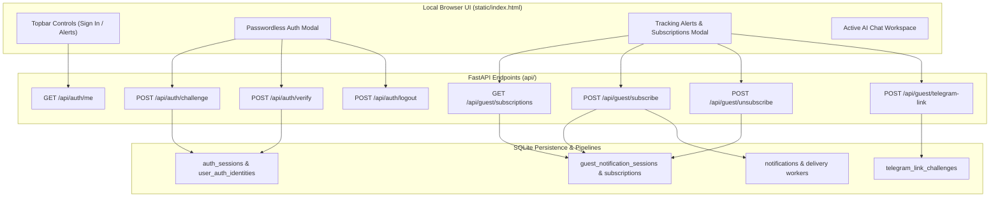

# Milestone 3 - Stage 14 Technical Architecture & Completion Report
**India Post AI Shipment Assistant**
**Date**: November 2026 | **Schema Version**: 11 | **Status**: Verified & Concluded (939/939 Tests Passing)

---

## 1. Executive Summary

Milestone 3 - Stage 14 seamlessly integrates the Milestone 3 backend capabilities (passwordless registered-user authentication, durable guest notification ownership, auditable consent tracking, and Telegram deep linking) into the user-facing local browser interface.

Key deliverables achieved:
1. **Registered User Authentication UI**:
   - Topbar authentication status indicator ("Sign In" / "User #<id>").
   - Two-step passwordless login modal (Email submission -> 6-digit numeric OTP challenge -> authenticated session).
   - User profile display with active session expiry and secure logout trigger.
2. **Guest Tracking Alerts & Subscription Management UI**:
   - "🔔 Tracking Alerts" topbar button opening a comprehensive subscription drawer/modal.
   - Active consignment subscription listing with real-time status badges and one-click unsubscription.
   - New consignment tracking subscription form supporting both Email and Telegram channels.
   - Mandatory explicit consent opt-in checkbox preventing unauthorized notification generation.
3. **Telegram Bot Deep Linking Banner**:
   - Dynamic deep link generation via `/api/guest/telegram-link`.
   - One-click CTA ("Open Telegram") launching `https://t.me/<bot_username>?start=<token>` to complete trusted recipient verification.
4. **Responsive & Accessible Design**:
   - Clean, lightweight vanilla JavaScript (`static/js/app.js`) and modular CSS (`static/css/style.css`).
   - Modal backdrop dismiss, keyboard shortcuts (Enter to submit, Esc/backdrop click to close), and full ARIA dialog labeling.

---

## 2. Component Integration

---

## 3. Test Verification & Evidence

Automated tests executed in project virtual environment:
- **Total Test Suites**: 45
- **Total Tests**: 939
- **Passing**: 939 (100%)
- **Failures / Errors**: 0
- **Execution Time**: 68.94s

### Stage 14 Focused Test Verification:
1. `test_local_application.py::test_index_serves_html_with_auth_and_alerts_ui` (**PASSED**)
2. `test_local_application.py::test_static_assets_are_served` (**PASSED**)
3. `test_api_auth_guest_and_webhooks.py` (7 tests, **PASSED**)
4. All 43 prior test suites (930 tests, **PASSED**)
