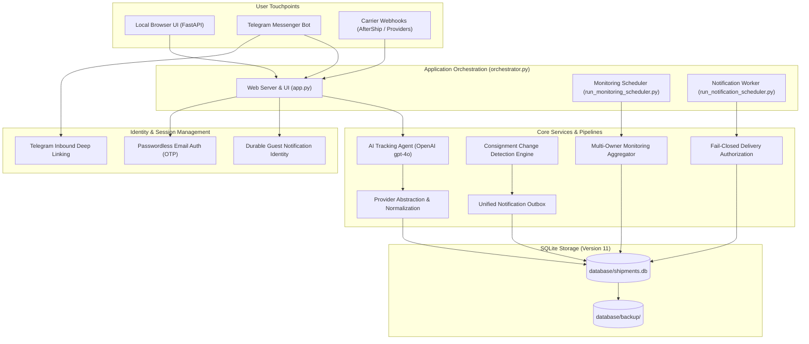

# India Post AI Shipment Assistant — Project Continuation Guide
**Version 7.00 | November 2026**
**Milestone 3 Conclusion & Production Handover**

---

## 1. Document Control & Historical Context

| Parameter | Record |
| :--- | :--- |
| **Document** | Project Continuation Guide V7.00 |
| **Project Root** | `C:\Projects\Google_Antigravity\IndiaPost_AI_Assistant` |
| **Active Python Environment** | Python 3.14.4 virtual environment (`venv\Scripts\python.exe`) |
| **Database Path** | `database/shipments.db` |
| **Installed Database Schema** | **Version 11** (Integrity Check: `ok`, Foreign Key Violations: `0`) |
| **Full Regression Baseline** | **946 passed in 34.20s across 46 test suites (0 failures)** |
| **Milestone Transition** | Milestone 1 (Stages 1–6) → Milestone 2 (Stages 7–12) → **Milestone 3 (Stages 13–15 Concluded)** |

---

## 2. Executive Product Architecture

The **India Post AI Shipment Assistant** is a channel-independent, AI-assisted consignment tracking and proactive notification platform.



---

## 3. Milestone & Stage Implementation History

### 3.1 Milestone 1 (Stages 1–6): Foundation Tracking & AI Integration
- Core consignment tracking workflow, AfterShip integration, and provider-independent status normalization.
- SQLite repositories for shipments, checkpoints, tracking checks, and conversations.
- Controlled AI tool schema and execution dispatch for OpenAI agent.

### 3.2 Milestone 2 (Stages 7–12): Intelligence, Reliability & Delivery Engine
- **Stage 7**: Intent classification, decision boundaries, shipment state explanations, and 39-scenario evaluation baseline.
- **Stage 8**: Carrier webhook ingress, event signature verification, idempotency, and durable replay protection.
- **Stage 9**: Proactive shipment monitoring scheduler, distributed worker leases, and crash recovery.
- **Stage 10**: Checkpoint-level change detection, notification policy intelligence, and transactional event pipelines.
- **Stage 11**: Multi-channel delivery architecture, outbound Telegram adapter, delivery attempts, and provider receipts (Migration 9).
- **Stage 12**: Production-readiness audits (PR-02 through PR-06), scheduler lifecycle, and local browser interface.

### 3.3 Milestone 3 (Stages 13–15): Enterprise Identity, Multi-Owner Notifications & Operations
- **Stage 13 (Backend Identity & Pipeline)**:
  - Applied Migration 11 transactionally.
  - Rebuilt `notifications` table in SQLite enforcing mutual exclusivity:
    `CHECK ((user_shipment_id IS NOT NULL AND guest_subscription_id IS NULL) OR (user_shipment_id IS NULL AND guest_subscription_id IS NOT NULL))`
  - Passwordless registered-user email authentication (6-digit OTP, attempt limits, rate limits, bearer sessions).
  - Durable guest notification identities and 30-day session cookies independent of ephemeral chats.
  - Inbound Telegram webhook linking extracting verified `chat_id` strictly from inbound messages.
  - Multi-owner monitoring aggregation (minimum interval, earliest next check).
  - Fail-closed real-time delivery authorization prior to dispatch.
  - FastAPI endpoints for auth (`/api/auth/*`), guest subscriptions (`/api/guest/*`), and Telegram webhooks (`/api/webhooks/telegram`).
- **Stage 14 (User Experience & Browser Integration)**:
  - Integrated Topbar controls: "Sign In" / User Profile and "🔔 Tracking Alerts".
  - Two-step passwordless login modal with code verification and profile state.
  - Subscriptions & Tracking Alerts modal: active consignment listing, channel selection (Email or Telegram), explicit consent enforcement, and one-click unsubscription.
  - Telegram bot deep link CTA (`https://t.me/<bot>?start=<token>`).
- **Stage 15 (Operational Tooling & Supervision)**:
  - Unified multi-process service supervisor (`orchestrator.py`) managing web server, monitoring scheduler, and notification worker.
  - Zero-lock online SQLite backup and retention tool (`scripts/backup_database.py`) with automated integrity and foreign key checks.
  - Health & diagnostics inspector (`scripts/health_inspector.py`) with non-leaking credential masking.
  - Operations and deployment runbook (`docs/RUNBOOK_OPERATIONS.md`).
  - Production Systemd service template (`deploy/systemd/indiapost-assistant.service`).

---

## 4. Database Schema Reference (Version 11)

The database at `database/shipments.db` contains 30 tables:
1. `users`: Registered user accounts.
2. `user_auth_identities`: Email-to-user mappings.
3. `auth_challenges`: Passwordless OTP challenges.
4. `auth_sessions`: Registered user bearer sessions.
5. `guest_notification_identities`: Durable guest subscriber entities.
6. `guest_notification_sessions`: Guest session tokens.
7. `guest_shipment_subscriptions`: Guest consignment tracking subscriptions.
8. `guest_notification_channel_preferences`: Guest notification channels & consent timestamps.
9. `telegram_link_challenges`: Single-use Telegram account linking tokens.
10. `shipments`: Canonical shipment records with latest status and timestamps.
11. `checkpoints`: Checkpoint event history with deduplication fingerprints.
12. `tracking_checks`: Attempt outcomes and provider response history.
13. `user_shipments`: Registered user consignment subscriptions.
14. `notification_channel_preferences`: Registered user notification channels.
15. `notifications`: Unified outbox queue with mutual exclusivity constraints.
16. `notification_delivery_attempts`: Detailed delivery attempt audit trail.
17. `notification_delivery_receipts`: Provider receipt confirmations.
18. `monitoring_jobs`: Aggregated shipment monitoring schedules and leases.
19. `webhook_events`: Inbound carrier webhook events and processing states.
20. `conversations`: Persistent chat conversation metadata.
21. `messages`: Conversation turns and contents.
22. `conversation_requests`: Request-level idempotency protection.
23. `conversation_tool_rounds`: Agent tool execution rounds.
24. `conversation_tool_calls`: Individual tool calls and outputs.
25. `local_web_sessions`: Browser session tokens for guest chat.
26. `local_web_session_conversations`: Session-to-conversation mappings.
27. `schema_migrations`: Schema migration version ledger (currently Version 11).
28-30. SQLite internal indexes and sequence tables.

---

## 5. Verification Matrix Summary

The complete project test suite consists of **946 tests across 46 test suites**:
- **Execution Time**: ~34.2 seconds.
- **Failures / Errors**: 0 (100% pass rate).
- **Core Verification Suites**:
  - `test_migration_11_auth_and_guest_ownership.py`: Schema 11 table structures & notification rebuild (5 tests).
  - `test_passwordless_authentication.py`: OTP challenges, rate limits, lockouts, sessions (10 tests).
  - `test_guest_and_telegram_linking.py`: Guest identity, consent, Telegram linking (8 tests).
  - `test_monitoring_aggregation_and_notification_pipeline.py`: Multi-owner aggregation & fail-closed authorization (5 tests).
  - `test_api_auth_guest_and_webhooks.py`: FastAPI auth, guest, and Telegram webhook routes (7 tests).
  - `test_local_application.py`: Web UI, static assets, HTML modals (11 tests).
  - `test_operational_tooling.py`: Database backup, diagnostics, orchestrator config (7 tests).
  - Prior 39 Regression Suites: Milestones 1 & 2 baseline functionality (893 tests).

---

## 6. External Operational Gates & Next Steps

All local application and service components are fully implemented, tested, and operational. The remaining operational gates are external and require user-provided credentials/approvals:

1. **OpenAI API Key Scoping**:
   - The key in `.env` returned HTTP 401 on live browser requests.
   - Runbook: [docs/RUNBOOK_OPERATIONS.md](file:///C:/Projects/Google_Antigravity/IndiaPost_AI_Assistant/docs/RUNBOOK_OPERATIONS.md#41-openai-api-key-configuration--http-401-reconciliation) provides step-by-step instructions to verify project scoping and model permissions (`gpt-4o`).
2. **AfterShip API Key Renewal**:
   - Polling remains in synthetic mock mode until the AfterShip subscription is renewed.
   - Runbook: [docs/RUNBOOK_OPERATIONS.md](file:///C:/Projects/Google_Antigravity/IndiaPost_AI_Assistant/docs/RUNBOOK_OPERATIONS.md#42-aftership-api-subscription-renewal) outlines renewing and enabling live polling.
3. **Live Telegram Bot Configuration**:
   - To dispatch real Telegram messages, obtain bot credentials from `@BotFather` and configure `TELEGRAM_BOT_TOKEN`, `TELEGRAM_BOT_USERNAME`, and `TELEGRAM_WEBHOOK_SECRET` per [docs/RUNBOOK_OPERATIONS.md](file:///C:/Projects/Google_Antigravity/IndiaPost_AI_Assistant/docs/RUNBOOK_OPERATIONS.md#43-live-telegram-bot-onboarding).

---

## 7. Handover Quick Reference

To start the complete assistant on Windows:
```powershell
.\scripts\start_assistant.ps1
```
To run health diagnostics:
```powershell
& ".\venv\Scripts\python.exe" scripts/health_inspector.py
```
To create an online database backup:
```powershell
& ".\venv\Scripts\python.exe" scripts/backup_database.py --keep 10
```
To execute the complete regression test suite:
```powershell
& ".\venv\Scripts\python.exe" -m pytest
```
